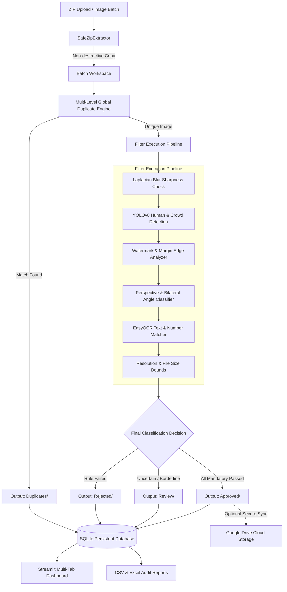

# AI-Powered Decoration Photo Filtering & Management Application

An enterprise-grade, non-destructive computer vision and data curation platform engineered for event decoration companies. Designed to ingest batches containing thousands of photographs via ZIP files or direct uploads, execute multi-stage quality and criteria filters, detect exact and perceptual duplicates across historical batches, and organize approved photographs into clean directory hierarchies.

---

## 1. System Architecture & Workflow



---

## 2. Technology Stack & Model Specifications

* **Frontend / Dashboard**: Streamlit 1.51+ (Interactive multi-tab operational interface)
* **Image Processing & Computer Vision**: OpenCV Headless 5.0+ and Pillow 12.0+
* **Cryptographic & Perceptual Hashing**:
  * Level 1: `hashlib.sha256` for bit-for-bit identical matching.
  * Level 2: `imagehash.phash` (Discrete Cosine Transform Perceptual Hashing) with configurable Hamming distance threshold (default $\le 6$).
  * Level 3: Normalized HSV histogram correlation for visual crop and re-compression matching.
* **Database & Persistence**: SQLite 3 with Write-Ahead Logging (`WAL` mode) and indexed hashes for fast cross-batch retrieval.
* **Reporting**: Pandas 2.3+ and OpenPyXL for CSV and Excel exports.
* **Optical Character Recognition (OCR)**:
  * Primary: **EasyOCR** (CRAFT text detection + ResNet recognition network). Automatically downloads weights on first use and caches locally to `~/.EasyOCR/model`.
  * Secondary fallback: PyTesseract (invoked if configured).
* **Human Detection**:
  * Primary: **YOLOv8 Nano (`yolov8n.pt`)** via Ultralytics. Automatically downloads compact 6.2MB weights on initialization.
  * Secondary CPU fallback: OpenCV HOG People Detector / Haar cascade.
* **Angle Classifier**: Bilateral horizontal symmetry index paired with Hough transform perspective line angle analysis.

---

## 3. Strict Data Safety Invariants

1. **Originals are Immutable**: Original ZIP files and original uploaded photos are treated as read-only. The system **never modifies, edits, or deletes** any original input file.
2. **Safe Workspace Extraction**: All extraction is staged in isolated `extracted/<batch_id>/` subdirectories with sanitized filenames.
3. **Collision-Proof Filenames**: Filenames are normalized with short SHA-256 prefixes (`<stem>_<hash[:8]><ext>`), preventing collisions even when zip archives contain identical names in nested folders.
4. **Relocation Without Deletion**: When an image is moved or removed from the "Approved" gallery, only the downstream output copy is relocated or deleted; original input source files remain intact.

---

## 4. Key Sections & Functional Modules

### 1. Dashboard
Displays real-time KPIs:
* Total uploaded images
* Total processed images
* Approved, Rejected, Review Required, and Duplicate counts
* Overall approval rate
* Breakdown charts and recent batch processing history

### 2. Upload Files
* Upload one or multiple ZIP archives simultaneously.
* Upload individual or multi-selected image files (`.jpg`, `.jpeg`, `.png`, `.webp`, `.bmp`, `.tiff`).
* Select target event category (e.g., First Birthday, Wedding, Haldi).
* Real-time progress bar with per-file status logs.

### 3. Dynamic Category Management
Categories are entirely dynamic and stored in SQLite. Create, edit, or delete categories with bespoke rules:
* **First Birthday**: Requires text `"Happy Birthday"`, required numbers `"1"` or `"ONE"`, front-angle preferred, human detection enabled (Reject), watermark detection enabled.
* **Second Birthday**: Requires text `"Happy Birthday"`, required numbers `"2"` or `"TWO"`.
* **Wedding / Engagement / Haldi / Baby Shower / Anniversary**: Customized rules per celebration style.

### 4. Dynamic Filter Builder & Sandbox
* Configure thresholds for:
  * Human Detection (Action: `REJECT` or `REVIEW`)
  * Blur Sharpness (Laplacian variance threshold)
  * Watermark / Logo / Stock stamp detection
  * Camera Angle (Front vs Side vs Other)
  * OCR Text Keywords (case-insensitive substring/token match)
  * Number Detection (digits `1, 2, 3` and words `ONE, TWO, THREE, FIRST, SECOND`)
  * Resolution bounds (min width / min height)
  * File size limits (min KB / max KB)
  * Custom AI natural language prompts
* **Interactive Sandbox**: Upload a single photo to simulate and visualize filter decisions before processing large batches.

### 5. Processing Results
* Batch-by-batch diagnostic breakdown.
* Frequency histogram of rejection causes (blur, missing text, watermark, human present, angle).
* Searchable and filterable data grid.

### 6. Manual Review Gallery
* Visual card gallery with responsive thumbnails.
* Displays detected blur score, camera angle, OCR text, watermark confidence, and human counts.
* Individual action buttons: **Approve**, **Reject**, **Remove from Approved**, **View Full Image**.
* **Bulk Approval** and **Bulk Rejection** toolbar.
* Built-in duplicate safeguard: Prevents approving any image that matches an existing approved record.

### 7. Duplicate Management
* Global deduplication view across all historical upload batches.
* Side-by-side comparison between the duplicate item and the canonical master record in the database.
* Manual override: "Mark as Distinct" if human operator overrides an automated duplicate match.
* **On-Demand Duplicate Lookup**: Test an arbitrary external photo to see if it exists in the database.

### 8. Audit Reports
* Export filtered or global data to **CSV** and **Excel (.xlsx)**.
* Includes all metadata: Filenames, file formats, dimensions, sizes, SHA-256, pHash, blur scores, detected text, numbers, angles, and decision reasons.

### 9. Settings & Google Drive Integration
* Configure pHash tolerance (default 6) and similarity thresholds.
* Toggle global vs per-category deduplication.
* **Google Drive Cloud Sync**:
  * Authenticate via Service Account JSON (`GDRIVE_SERVICE_ACCOUNT_JSON`).
  * Specify destination Google Drive Folder ID (`GDRIVE_FOLDER_ID`).
  * Test connection with permission check.
  * One-click synchronization of approved photos to Google Drive.

---

## 5. Output Directory Structure

Processed output is systematically organized:

```
output/
├── First_Birthday_Decoration/
│   ├── Approved/
│   ├── Review/
│   ├── Rejected/
│   └── Duplicates/
├── Second_Birthday_Decoration/
│   ├── Approved/
│   ├── Review/
│   ├── Rejected/
│   └── Duplicates/
├── Wedding_Decoration/
│   ├── Approved/
│   ├── Review/
│   ├── Rejected/
│   └── Duplicates/
└── Reports/
    ├── CSV/
    └── Excel/
```

---

## 6. Installation & Quickstart

### Prerequisites
* Python 3.10+
* Windows 10/11, macOS, or Linux

### Step 1: Clone or Navigate to Directory
```bash
cd decoration_photo_ai
```

### Step 2: Install Dependencies
```bash
pip install -r requirements.txt
```

### Step 3: Run the Streamlit Application
```bash
streamlit run app.py
```
Open your browser to `http://localhost:8501`.

---

## 7. Running the Automated Test Suite

The test suite validates database persistence, zip extraction, multi-level deduplication, computer vision filters, report generation, and all 8 user acceptance criteria.

To execute all tests:
```bash
python -m unittest discover tests
```

To run individual test modules:
```bash
# 1. Database & Persistence Tests
python -m unittest tests.test_database

# 2. Safe Zip Extraction & Ingestion Tests
python -m unittest tests.test_zip_extractor

# 3. Multi-Level Duplicate Detection Tests
python -m unittest tests.test_duplicate_detector

# 4. Computer Vision & OCR Filter Tests
python -m unittest tests.test_filters

# 5. Report Generator (CSV & Excel) Tests
python -m unittest tests.test_report_generator

# 6. Complete 8-Step Acceptance Pipeline Tests
python -m unittest tests.test_full_pipeline
```
